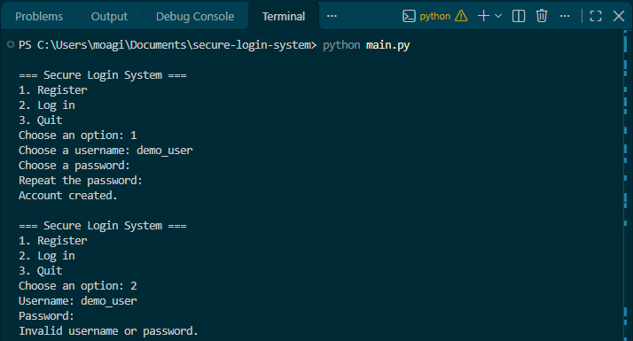

# Secure Login System

A command-line registration and login system in Python, built to show how authentication should be done securely: salted password hashing, protection against SQL injection, account lockout and security logging.



## Features

- **Registration** with username and password rules
- **Login** with account lockout after repeated failures
- **Salted password hashing** using PBKDF2-HMAC-SHA256 (600,000 iterations)
- **SQLite storage** with parameterised queries
- **Security log** of registrations, failed logins and lockouts
- **22 automated tests**
- Uses only the Python standard library, with nothing to install

## Security decisions

| Risk | How this project handles it |
|---|---|
| Stolen database | Passwords are never stored. Only a salted, slow hash is saved, so each password must be attacked individually. |
| Rainbow tables | A random 16-byte salt is generated for every user, so identical passwords produce different hashes. |
| Brute-force guessing | After 5 wrong passwords the account locks for 5 minutes. |
| SQL injection | Every query uses `?` placeholders, so user input is never part of the SQL command. |
| Username enumeration | An unknown user and a wrong password get the same error message and similar response time. |
| Timing attacks | Hashes are compared with `hmac.compare_digest`. |
| Log injection | Usernames are cleaned before being written to the log, so nobody can forge log entries. |
| Weak passwords | Minimum 10 characters with upper case, lower case, a number and a symbol. Common passwords and passwords containing the username are rejected. |
| Password exposure | Passwords are read with `getpass` and never written to the log. |

## How to run

Requires Python 3.9 or newer.

```
git clone https://github.com/Agi07/secure-login-system.git
cd secure-login-system
python main.py
```

## Run the tests

```
python -m unittest -v
```

## Project structure

```
auth.py              password hashing and verification
database.py          SQLite storage and queries
validation.py        username and password rules
service.py           register and login logic, lockout
security_log.py      security event logging
main.py              command-line menu
test_secure_login.py automated tests
```

## Limitations

This is a learning project, not production software.

- It is a command-line program with no web interface or multi-factor authentication.
- The list of common passwords is a small sample. Real systems check much larger lists.
- Account lockout can itself be abused to lock other people out. Production systems combine it with rate limiting and other defences.
- Lockout state is stored per account, not per IP address.

## What I learned

How password hashing, salting and key stretching work, why parameterised queries stop SQL injection, and how to write tests that prove security rules still hold when the code changes.

Built by Moagi Makhudu, BSc Information Technology student.